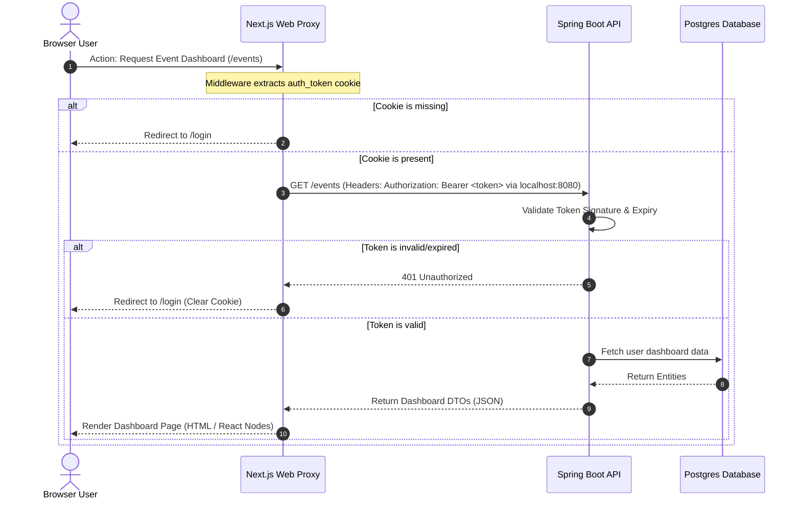
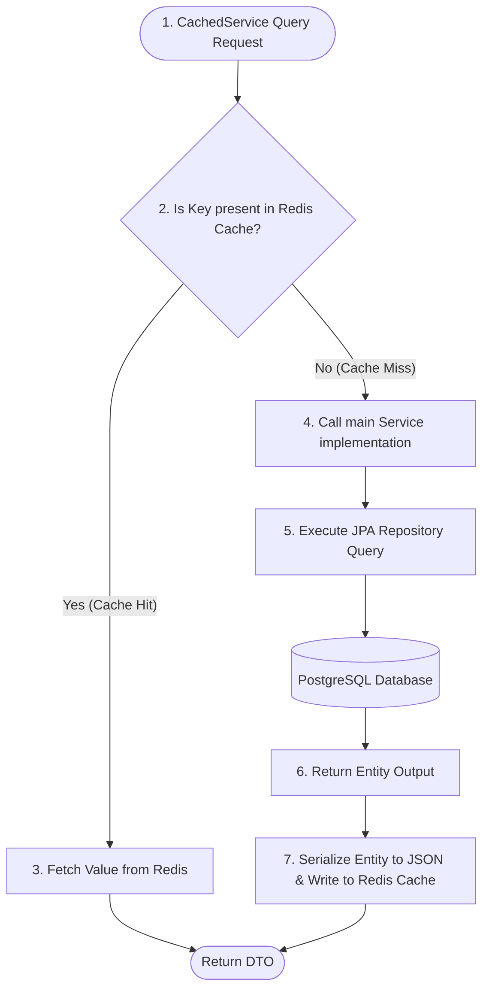

# System Architecture & Design Specification

This document details the high-level system architecture, request lifecycle, data flow, and authentication mechanisms of **planohi-app-v4**.

---

## 1. System Components Overview

The application is structured as a **Modular Monolith** running within a consolidated single-task multi-container AWS ECS Fargate deployment:

```mermaid
graph TD
    subgraph Browser ["Client Interface (Browser)"]
        UI[Next.js Client Components]
        SC[Next.js Server Components]
    end

    subgraph FargateTask ["AWS ECS Fargate Task (Public Subnet)"]
        subgraph WebServer ["Web Container (Next.js Node)"]
            Middleware["proxy.ts / Middleware (Cookie Auth Validator)"]
            Routes[API Route Handlers /route.ts]
        end

        subgraph APIServer ["API Container (Spring Boot Monolith)"]
            Controller[REST Controllers]
            Security[Spring Security / Token Verification]
            CachedService[Cached Service Layer]
            Service[Business Service Layer]
            EventPublisher[Spring Event Publisher]
            EmailListener[Email Event Listener]
            LogListener[Activity Log Listener]
            Repository[Spring Data JPA Repositories]
        end
    end

    subgraph DataStorage ["AWS Databases (Private Subnet)"]
        DB[(PostgreSQL Database)]
        Cache[(Redis Cache)]
    end

    subgraph ExternalServices ["External Systems"]
        SES[Amazon SES]
    end

    %% Client Interactions
    UI -->|1. Client Fetch /api/proxy/*| Middleware
    SC -->|2. Direct Server Fetch| Controller
    
    %% Middleware Delegation
    Middleware -->|3. Route Request| Routes
    Routes -->|4. Forward HTTP Request via localhost:8080| Controller

    %% Backend Execution
    Controller --> Security
    Security --> CachedService
    CachedService --> Service
    
    %% In-Memory Event Processing
    Service -->|Publish Asynchronous Event| EventPublisher
    EventPublisher -->|EmailSendEvent (Async)| EmailListener
    EventPublisher -->|ActivityLogEvent (Async)| LogListener

    %% Async operations
    EmailListener -->|5. Send Email| SES
    LogListener -->|6. Save Log| Repository
    
    %% Cache & Database Access
    CachedService -->|7. Read/Write Cache| Cache
    Service -->|8. Query Data (Cache Miss)| Repository
    Repository -->|9. SQL Command| DB
```

---

## 2. Authentication & Request Flow Lifecycle

The system utilizes cookie-based authentication on the client-side for enhanced security, while translating requests into stateless JWT bearer headers when interacting with the Spring Boot backend services.

### Auth Exchange Sequence



---

## 3. Cache-Aside Pattern Lifecycle (Redis & Database)

To optimize query operations, service implementations must deploy a Cache-Aside strategy structured in the CachedService layer:



---

## 4. In-Memory Event Dispatching (Asynchronous Workers)

Asynchronous background processes (such as email delivery and system activity logging) are processed in-memory using Spring Boot's internal event listener subsystem:

1. **Transactional Event Listeners**:
   To prevent processing background events for operations that fail or roll back, listeners are annotated with `@TransactionalEventListener(phase = TransactionPhase.AFTER_COMMIT)`. The listener will only run if the database transaction commits successfully.
2. **Asynchronous Thread Pool**:
   Listeners are annotated with `@Async` to hand off execution to a dedicated thread pool, allowing the initial user request thread to return immediately.
3. **MDC Logging Context Propagation**:
   Logging correlation IDs are copied across asynchronous threads using a custom `MdcTaskDecorator` to maintain tracing consistency in log outputs.

---

## 5. Infrastructure Sizing and Scaling Strategy

To ensure that the consolidated infrastructure can scale horizontally or vertically, resource limits are parameterized in the Terraform settings:

* **Horizontal Scaling (Task Count)**:
  Controlled via the `ecs_task_count` variable. Upscaling the service desired count will spin up additional consolidated tasks sharing load-balancer traffic.
* **Vertical Scaling (Task Sizing)**:
  Controlled via the `ecs_task_cpu` and `ecs_task_memory` variables, enabling Fargate instances to scale from `1024/2048` (1 vCPU, 2 GB RAM) up to production limits as needed.
* **Database & Cache Instance Class**:
  RDS postgres sizing is parameterized using `rds_instance_class` (default `db.t4g.micro`), and Redis node types are parameterized using `redis_node_type` (default `cache.t4g.micro`).

---

## 6. Key Architectural Standards

1. **Localhost Container Networking**: Next.js frontend calls the Spring Boot API backend directly via `http://localhost:8080` as they share the same ECS task container network namespace.
2. **Immutable History**: Database schemas are strictly modified through Flyway scripts, ensuring all environments (Local, Staging, Production) transition identically.
3. **Stateless Backend**: The Spring Boot backend keeps no session state in memory. Any shared session variables are either signed inside token payloads or persisted inside Redis.
