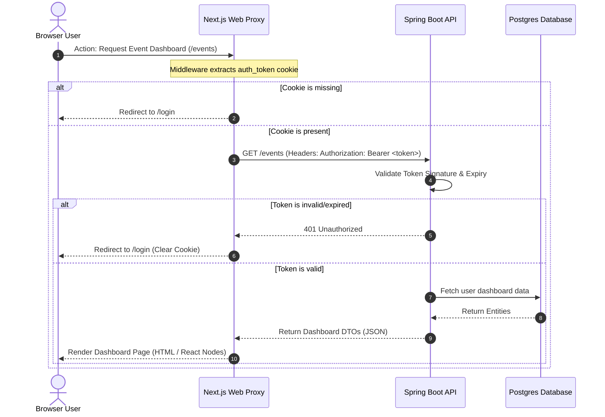

# System Architecture & Design Specification

This document details the high-level system architecture, request lifecycle, data flow, and authentication mechanisms of **planohi-app-v4**.

---

## 1. System Components Overview

The application is structured into four main isolated layers orchestrated via Docker containers:

```mermaid
graph TD
    subgraph Browser ["Client Interface (Browser)"]
        UI[Next.js Client Components]
        SC[Next.js Server Components]
    end

    subgraph WebServer ["Web Engine (Next.js Node Container)"]
        Middleware["proxy.ts / Middleware (Cookie Auth Validator)"]
        Routes[API Route Handlers /route.ts]
    end

    subgraph APIServer ["API Backend (Spring Boot Container)"]
        Controller[REST Controllers]
        Security[Spring Security / Token Verification]
        CachedService[Cached Service Layer]
        Service[Business Service Layer]
        Repository[Spring Data JPA Repositories]
    end

    subgraph DataStorage ["Data & Cache Storage Containers"]
        DB[(PostgreSQL Database)]
        Cache[(Redis Cache)]
    end

    %% Client Interactions
    UI -->|1. Client Fetch /api/proxy/*| Middleware
    SC -->|2. Direct Server Fetch| Controller
    
    %% Middleware Delegation
    Middleware -->|3. Route Request| Routes
    Routes -->|4. Forward HTTP Request + Bearer Token| Controller

    %% Backend Execution
    Controller --> Security
    Security --> CachedService
    CachedService --> Service
    
    %% Cache & Database Access
    CachedService -->|5. Read/Write Cache| Cache
    Service -->|6. Query Data (Cache Miss)| Repository
    Repository -->|7. SQL Command| DB
```

---

## 2. Authentication & Request Flow Lifecycle

The system utilizes cookie-based authentication on the client-side for enhanced security, while translating requests into stateless JWT bearer headers when interacting with the Spring Boot backend services.

### Auth Exchange Sequence



---

## 3. Cache-Aside Pattern Lifecycle (Redis & Database)

To optimize query operations, service implementations must deploy a Cache-Aside strategy structured in the CachedService layer:


---

## 4. Key Architectural Standards

1. **Decoupled Development**: The Next.js layer should never access the PostgreSQL database or Redis cache directly. All state queries and mutations must route through the Spring Boot API.
2. **Immutable History**: Database schemas are strictly modified through Flyway scripts, ensuring all environments (Local, Staging, Production) transition identically.
3. **Stateless Backend**: The Spring Boot backend keeps no session state in memory. Any shared session variables are either signed inside token payloads or persisted inside Redis.
