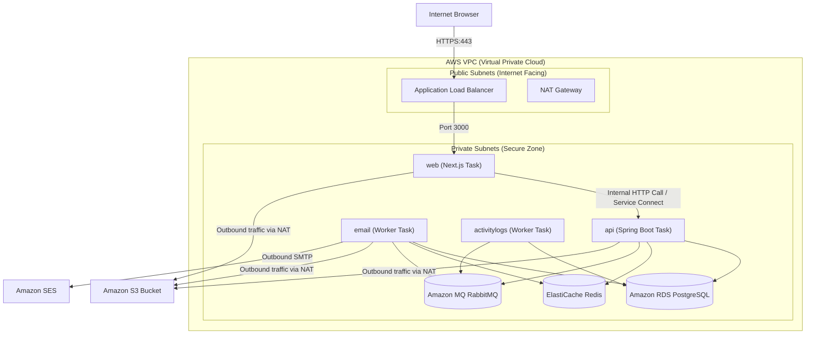

# AWS Deployment Guide with Terraform

This guide is a beginner-friendly, step-by-step walkthrough for deploying the **planohi-app-v4** application stack to AWS (Amazon Web Services) using **Terraform** by HashiCorp. 

It maps the local environment defined in your [docker-compose.yml](file:///c:/Users/jayma/Documents/GitRepo-1/planohi-app-v4/docker-compose.yml) into production-ready, managed AWS services, keeping security, scalability, and ease of maintenance in mind.

---

## 1. Local Container vs. AWS Service Mapping

Before writing infrastructure code, it is important to understand how our local Docker Compose services translate into the AWS ecosystem. Rather than hosting databases and queues inside basic virtual machines (which requires manual updates, backup setups, and scaling work), we use **AWS Managed Services**.

| Docker Compose Service | Local Tech/Image | AWS Managed Service | Description / Rationale |
| :--- | :--- | :--- | :--- |
| **db** | `postgres:16-alpine` | **Amazon RDS PostgreSQL** | Fully managed database. RDS automates backups, security patching, and provides easy vertical/horizontal scaling. |
| **cache** | `redis:7-alpine` | **Amazon ElastiCache Serverless for Redis** | Serverless key-value store. It scales cache capacity automatically, eliminating the need to size nodes manually. |
| **localstack** | `localstack/localstack` (S3) | **Amazon S3** | Object storage bucket for storing banner uploads. S3 is highly durable and virtually infinite in size. |
| **rabbitmq** | `rabbitmq:3.13-management` | **Amazon MQ for RabbitMQ** | Managed RabbitMQ broker. AWS manages clustering, scaling, and OS-level patching. |
| **maildev** | `maildev/maildev` | **Amazon SES (Simple Email Service)** | Cloud-based email sending service, replacing the mock local developer SMTP server. |
| **api** / **web** / **email** / **activitylogs** | Custom Dockerfiles | **AWS ECS Fargate** | A serverless container runtime. You run your containers directly without managing underlying EC2 virtual servers. |
| **app-network** | Docker Bridge Network | **Amazon VPC (Virtual Private Cloud)** | A private isolated network with public subnets (accessible from the web) and private subnets (hidden databases/services). |
| **Ports Exposing** (e.g. `3000:3000`) | Direct port mapping | **AWS ALB (Application Load Balancer)** | Route secure HTTPS traffic from the public web directly into the private Next.js containers. |
| **Secrets & Keys** | Plain text `.env` parameters | **AWS Secrets Manager** | Encrypted key-value credentials store. Replaces plain-text passwords and keys inside container configurations, keeping them secure from console/log viewing. |

---

## 2. Target Architecture

The diagram below illustrates how traffic flows through your AWS infrastructure. To maximize security, the database, cache, message broker, and background worker containers are isolated in **Private Subnets** with no direct internet access. Only the Application Load Balancer (ALB) and Next.js frontend are accessible from the internet.



---

## 3. Prerequisites for Beginners

To deploy your application, you must set up the following tools on your local computer:

1. **AWS Account**: If you do not have one, sign up at [aws.amazon.com](https://aws.amazon.com).
2. **AWS CLI (Command Line Interface)**: Used to log in to AWS from your command terminal.
   - [AWS CLI Install Guide](https://docs.aws.amazon.com/cli/latest/userguide/getting-started-install.html)
3. **Terraform CLI**: Used to write and deploy the infrastructure.
   - [Terraform Install Guide](https://developer.hashicorp.com/terraform/downloads)
4. **Docker Desktop**: Needed to build your local images and push them to AWS ECR.
   - [Docker Install Guide](https://docs.docker.com/get-docker/)

### Step-by-Step CLI Authentication Setup
Once the AWS CLI is installed, log into your AWS console, navigate to **IAM (Identity and Access Management)**, create a user with programmatic access (AdministratorAccess for initial setup is common for learning), and retrieve your **Access Key ID** and **Secret Access Key**. 

Run the following command in your terminal and enter your keys:
```bash
aws configure
```
*Recommended region to input:* `ap-northeast-1` (Tokyo, matching your current local settings) or your preferred region.

---

## 4. Terraform Workspace Directory Structure

All of your infrastructure configuration files will live inside the `infra/terraform/` folder in your project repository. We use a **Structured Single-Folder Layout**, keeping resources separated into logically named files for readability.

Create the files inside `infra/terraform/` as shown below:
```text
planohi-app-v4/
└── infra/
    └── terraform/
        ├── providers.tf         # Configures AWS provider & backend state
        ├── backend.tfvars       # Parameterized S3 backend configuration values
        ├── variables.tf         # Input parameters (database names, ports, domain)
        ├── vpc.tf               # Virtual network, subnets, route tables, NAT Gateway
        ├── security_groups.tf   # Firewall rules defining who can talk to whom
        ├── s3.tf                # S3 bucket for banner image uploads & IAM access rules
        ├── rds.tf               # Managed PostgreSQL Database Instance
        ├── elasticache.tf       # Managed Redis Serverless Cluster
        ├── rabbitmq.tf          # Amazon MQ RabbitMQ broker
        ├── secrets.tf           # Secure container for passwords, integration keys, and tokens
        ├── alb.tf               # Load balancer setup routing traffic to Next.js
        ├── ecs.tf               # ECS Clusters, Task Definitions, and Fargate Services
        └── outputs.tf           # Endpoints/URLs printed after successful deployment
```

---

## 5. Terraform Code Walkthrough

Below are the contents for each of the files in your Terraform folder. Every resource includes inline comments to explain what it does.

### A. Providers Configuration (`providers.tf`)
This file tells Terraform that we are using AWS and specifies the required version.

```hcl
terraform {
  required_version = ">= 1.5.0"
  required_providers {
    aws = {
      source  = "hashicorp/aws"
      version = "~> 5.0"
    }
  }
  
  # Empty backend block to allow parameterization via a backend.tfvars file
  backend "s3" {}
}

provider "aws" {
  region = var.aws_region
  default_tags {
    tags = {
      Environment = var.environment
      Project     = "planohi"
      ManagedBy   = "Terraform"
    }
  }
}
```

### B. Input Variables (`variables.tf`)
Variables prevent hardcoding and allow you to configure environments dynamically (e.g., swapping database passwords without changing code).

```hcl
variable "aws_region" {
  type        = string
  default     = "ap-northeast-1"
  description = "AWS region where resources will be created"
}

variable "environment" {
  type        = string
  default     = "staging"
  description = "Deployment environment name (e.g. dev, staging, prod)"
}

variable "domain_name" {
  type        = string
  description = "The root domain name for the application (e.g., planohi.com)"
  default     = "planohi.local"
}

variable "db_name" {
  type        = string
  default     = "planohidb"
  description = "Database name"
}

variable "db_username" {
  type        = string
  default     = "planohiuser"
  description = "Database administrator username"
}

variable "db_password" {
  type        = string
  sensitive   = true
  description = "Database administrator password (keep this secure!)"
}

variable "db_backup_retention_period" {
  type        = number
  default     = 7
  description = "The number of days to retain automated database backups. Set to 0 to disable backups."
}

variable "rabbitmq_username" {
  type        = string
  default     = "planohimquser"
  description = "RabbitMQ broker administrator username"
}

variable "rabbitmq_password" {
  type        = string
  sensitive   = true
  description = "RabbitMQ broker administrator password (must be 12+ chars, no special chars except subset)"
}

variable "jwt_secret_key" {
  type        = string
  sensitive   = true
  description = "Secret key for signing JWT tokens"
}

variable "jwt_role_secret_key" {
  type        = string
  sensitive   = true
  description = "Secret key for signing JWT user roles"
}

variable "security_api_key" {
  type        = string
  sensitive   = true
  description = "API key used to authenticate internal system integrations"
}
```

### C. Network Setup (`vpc.tf`)
This creates an isolated sandbox network. We define:
- **Public Subnets**: Containers here are assigned public IP addresses (used for our Load Balancer).
- **Private Subnets**: Containers here have no public IPs. They can reach the internet using the **NAT Gateway** to pull packages or send emails, but the internet cannot reach them.

```hcl
# Create the VPC
resource "aws_vpc" "main" {
  cidr_block           = "10.0.0.0/16"
  enable_dns_hostnames = true
  enable_dns_support   = true

  tags = {
    Name = "planohi-vpc-${var.environment}"
  }
}

# Fetch the list of available AZs (Availability Zones) in the region
data "aws_availability_zones" "available" {
  state = "available"
}

# Create Public Subnets (AZ-1 & AZ-2)
resource "aws_subnet" "public" {
  count                   = 2
  vpc_id                  = aws_vpc.main.id
  cidr_block              = "10.0.${count.index}.0/24"
  availability_zone       = data.aws_availability_zones.available.names[count.index]
  map_public_ip_on_launch = true

  tags = {
    Name = "planohi-public-subnet-${count.index}-${var.environment}"
  }
}

# Create Private Subnets (AZ-1 & AZ-2)
resource "aws_subnet" "private" {
  count             = 2
  vpc_id            = aws_vpc.main.id
  cidr_block        = "10.0.${count.index + 10}.0/24"
  availability_zone = data.aws_availability_zones.available.names[count.index]

  tags = {
    Name = "planohi-private-subnet-${count.index}-${var.environment}"
  }
}

# Internet Gateway to connect the VPC to the internet
resource "aws_internet_gateway" "igw" {
  vpc_id = aws_vpc.main.id

  tags = {
    Name = "planohi-igw-${var.environment}"
  }
}

# Elastic IP for the NAT Gateway
resource "aws_eip" "nat" {
  domain = "vpc"
}

# NAT Gateway inside Public Subnet 0 so private containers can request external pages
resource "aws_nat_gateway" "nat" {
  allocation_id = aws_eip.nat.id
  subnet_id     = aws_subnet.public[0].id

  tags = {
    Name = "planohi-nat-gateway-${var.environment}"
  }
}

# Route table for public subnet (points traffic to Internet Gateway)
resource "aws_route_table" "public" {
  vpc_id = aws_vpc.main.id

  route {
    cidr_block = "0.0.0.0/0"
    gateway_id = aws_internet_gateway.igw.id
  }

  tags = {
    Name = "planohi-public-rt-${var.environment}"
  }
}

# Route table for private subnet (points traffic to NAT Gateway)
resource "aws_route_table" "private" {
  vpc_id = aws_vpc.main.id

  route {
    cidr_block     = "0.0.0.0/0"
    nat_gateway_id = aws_nat_gateway.nat.id
  }

  tags = {
    Name = "planohi-private-rt-${var.environment}"
  }
}

# Associate Public Subnets with Public Route Table
resource "aws_route_table_association" "public" {
  count          = 2
  subnet_id      = aws_subnet.public[count.index].id
  route_table_id = aws_route_table.public.id
}

# Associate Private Subnets with Private Route Table
resource "aws_route_table_association" "private" {
  count          = 2
  subnet_id      = aws_subnet.private[count.index].id
  route_table_id = aws_route_table.private.id
}
```

### D. Security Firewalls (`security_groups.tf`)
Security Groups act as virtual firewalls to control inbound and outbound traffic.

```hcl
# ALB Security Group (Allows public access to the web app)
resource "aws_security_group" "alb" {
  name        = "planohi-alb-sg-${var.environment}"
  description = "Allow TLS/HTTP inbound traffic to ALB"
  vpc_id      = aws_vpc.main.id

  ingress {
    description = "Allow HTTP"
    from_port   = 80
    to_port     = 80
    protocol    = "tcp"
    cidr_blocks = ["0.0.0.0/0"]
  }

  ingress {
    description = "Allow HTTPS"
    from_port   = 443
    to_port     = 443
    protocol    = "tcp"
    cidr_blocks = ["0.0.0.0/0"]
  }

  egress {
    description = "Allow outbound"
    from_port   = 0
    to_port     = 0
    protocol    = "-1"
    cidr_blocks = ["0.0.0.0/0"]
  }
}

# ECS Security Group (Allows incoming traffic only from the Load Balancer)
resource "aws_security_group" "ecs" {
  name        = "planohi-ecs-sg-${var.environment}"
  description = "Control traffic entering containers"
  vpc_id      = aws_vpc.main.id

  ingress {
    description     = "Allow web app port from ALB"
    from_port       = 3000
    to_port         = 3000
    protocol        = "tcp"
    security_groups = [aws_security_group.alb.id]
  }

  ingress {
    description     = "Allow internal API port from containers in this security group"
    from_port       = 8080
    to_port         = 8080
    protocol        = "tcp"
    self            = true
  }

  egress {
    description = "Allow outbound to internet (downloads, API calls)"
    from_port   = 0
    to_port     = 0
    protocol    = "-1"
    cidr_blocks = ["0.0.0.0/0"]
  }
}

# Database Security Group (Only allows Postgres access from containers)
resource "aws_security_group" "db" {
  name   = "planohi-db-sg-${var.environment}"
  vpc_id = aws_vpc.main.id

  ingress {
    description     = "Allow Postgres port from ECS containers"
    from_port       = 5432
    to_port         = 5432
    protocol        = "tcp"
    security_groups = [aws_security_group.ecs.id]
  }

  egress {
    from_port   = 0
    to_port     = 0
    protocol    = "-1"
    cidr_blocks = ["0.0.0.0/0"]
  }
}

# Cache Security Group (Only allows Redis access from containers)
resource "aws_security_group" "redis" {
  name   = "planohi-redis-sg-${var.environment}"
  vpc_id = aws_vpc.main.id

  ingress {
    description     = "Allow Redis port from ECS containers"
    from_port       = 6379
    to_port         = 6379
    protocol        = "tcp"
    security_groups = [aws_security_group.ecs.id]
  }

  egress {
    from_port   = 0
    to_port     = 0
    protocol    = "-1"
    cidr_blocks = ["0.0.0.0/0"]
  }
}

# MQ Security Group (Only allows RabbitMQ ports from containers)
resource "aws_security_group" "rabbitmq" {
  name   = "planohi-rabbitmq-sg-${var.environment}"
  vpc_id = aws_vpc.main.id

  ingress {
    description     = "Allow AMQPS secure messaging port from ECS containers"
    from_port       = 5671
    to_port         = 5671
    protocol        = "tcp"
    security_groups = [aws_security_group.ecs.id]
  }

  ingress {
    description     = "Allow standard AMQP port from ECS containers"
    from_port       = 5672
    to_port         = 5672
    protocol        = "tcp"
    security_groups = [aws_security_group.ecs.id]
  }

  egress {
    from_port   = 0
    to_port     = 0
    protocol    = "-1"
    cidr_blocks = ["0.0.0.0/0"]
  }
}
```

### E. Storage Configuration (`s3.tf`)
Configures the bucket for uploading banners. In AWS production, we restrict public write permissions but configure settings so presigned download links work.

```hcl
# Random suffix generator so our S3 bucket has a unique global name
resource "random_id" "bucket_suffix" {
  byte_length = 4
}

# S3 Bucket for Banners
resource "aws_s3_bucket" "banners" {
  bucket        = "planohi-banners-${var.environment}-${random_id.bucket_suffix.hex}"
  force_destroy = true
}

# Disable public block rules so public reads are possible if using public assets
resource "aws_s3_bucket_public_access_block" "banners_access" {
  bucket = aws_s3_bucket.banners.id

  block_public_acls       = false
  block_public_policy     = false
  ignore_public_acls      = false
  restrict_public_buckets = false
}

# Bucket CORS configuration (allows Next.js / Browser direct requests)
resource "aws_s3_bucket_cors_configuration" "banners_cors" {
  bucket = aws_s3_bucket.banners.id

  cors_rule {
    allowed_headers = ["*"]
    allowed_methods = ["GET", "PUT", "POST", "DELETE", "HEAD"]
    allowed_origins = ["*"] # Adapt in production to allow only your domain
    max_age_seconds = 3000
  }
}
```

### F. Managed PostgreSQL Database (`rds.tf`)
Spins up a managed PostgreSQL database in the private subnets.

```hcl
# Define database subnet group (spreads DB network layer across AZs for resilience)
resource "aws_db_subnet_group" "db" {
  name       = "planohi-db-subnet-group-${var.environment}"
  subnet_ids = aws_subnet.private[*].id

  tags = {
    Name = "planohi-db-subnet-group"
  }
}

# Spin up Postgres 16 Engine DB Instance
resource "aws_db_instance" "postgres" {
  identifier             = "planohi-db-${var.environment}"
  allocated_storage      = 20
  max_allocated_storage  = 100
  engine                 = "postgres"
  engine_version         = "16"
  instance_class         = "db.t4g.micro" # Entry tier instance, cost-efficient for testing
  db_name                = var.db_name
  username               = var.db_username
  password               = var.db_password
  db_subnet_group_name   = aws_db_subnet_group.db.name
  vpc_security_group_ids = [aws_security_group.db.id]
  backup_retention_period = var.db_backup_retention_period
  storage_encrypted      = true
  skip_final_snapshot    = true # Skip backup during terraform destroy to prevent errors
}
```

### G. Serverless Redis Cache (`elasticache.tf`)
Deploys a serverless Redis cache cluster which handles scaling and node sizing automatically.

```hcl
# Subnet group for Redis cluster
resource "aws_elasticache_subnet_group" "redis" {
  name       = "planohi-redis-subnet-group-${var.environment}"
  subnet_ids = aws_subnet.private[*].id
}

# Redis Serverless Cache Resource
resource "aws_elasticache_serverless_cache" "redis" {
  name       = "planohi-cache-${var.environment}"
  engine     = "redis"
  major_engine_version = "7"
  
  subnet_ids         = aws_subnet.private[*].id
  security_group_ids = [aws_security_group.redis.id]

  cache_usage_limits {
    data_storage {
      maximum = 5 # limit to 5 GB storage to keep costs down
      unit    = "GB"
    }
  }
}
```

### H. Amazon MQ for RabbitMQ (`rabbitmq.tf`)
Spins up a single-instance RabbitMQ queue engine in the private subnet.

```hcl
# Amazon MQ RabbitMQ Broker
resource "aws_mq_broker" "rabbitmq" {
  broker_name = "planohi-rabbitmq-${var.environment}"
  engine_type = "RabbitMQ"
  engine_version = "3.13"
  auto_minor_version_upgrade = true
  host_instance_type = "mq.m7g.medium" # Entry tier broker instance (Graviton3-based)
  
  security_groups    = [aws_security_group.rabbitmq.id]
  subnet_ids         = [aws_subnet.private[0].id] # Single AZ configuration for dev/staging costs
  deployment_mode    = "SINGLE_INSTANCE"
  publicly_accessible = false

  user {
    username = var.rabbitmq_username
    password = var.rabbitmq_password
  }
}
```

### I. Secrets Management (`secrets.tf`)
This file configures AWS Secrets Manager to store all credentials inside a single encrypted JSON object. Using one JSON secret is highly cost-effective (since AWS charges per secret) and provides a secure, consolidated repository.

```hcl
# Create the secret configuration
resource "aws_secretsmanager_secret" "app_secrets" {
  name                    = "planohi-app-secrets-${var.environment}"
  description             = "Encrypted application passwords and keys for planohi"
  recovery_window_in_days = 0 # Allows immediate cleanup during testing / teardown
}

# Add the sensitive parameters inside a JSON string
resource "aws_secretsmanager_secret_version" "app_secrets_val" {
  secret_id = aws_secretsmanager_secret.app_secrets.id
  secret_string = jsonencode({
    db_password         = var.db_password
    rabbitmq_password   = var.rabbitmq_password
    jwt_secret_key      = var.jwt_secret_key
    jwt_role_secret_key = var.jwt_role_secret_key
    security_api_key    = var.security_api_key
  })
}
```

### J. Application Load Balancer (`alb.tf`)
Receives secure HTTP requests from clients and routes them directly to the Next.js `web` container.

```hcl
# Create ALB
resource "aws_lb" "external" {
  name               = "planohi-alb-${var.environment}"
  internal           = false
  load_balancer_type = "application"
  security_groups    = [aws_security_group.alb.id]
  subnets            = aws_subnet.public[*].id
}

# Web (Next.js) Target Group
resource "aws_lb_target_group" "web" {
  name        = "planohi-web-tg-${var.environment}"
  port        = 3000
  protocol    = "HTTP"
  vpc_id      = aws_vpc.main.id
  target_type = "ip"

  health_check {
    path                = "/"
    port                = "3000"
    healthy_threshold   = 3
    unhealthy_threshold = 3
    timeout             = 5
    interval            = 30
    matcher             = "200"
  }
}

# Public ALB HTTP Default Listener (redirects to HTTPS in production, simple HTTP for initial setup)
resource "aws_lb_listener" "http" {
  load_balancer_arn = aws_lb.external.arn
  port              = "80"
  protocol          = "HTTP"

  default_action {
    type             = "forward"
    target_group_arn = aws_lb_target_group.web.arn
  }
}

# (Optional Setup for SSL/HTTPS with ACM certificate)
# resource "aws_lb_listener" "https" {
#   load_balancer_arn = aws_lb.external.arn
#   port              = "443"
#   protocol          = "HTTPS"
#   ssl_policy        = "ELBSecurityPolicy-2016-08"
#   certificate_arn   = var.ssl_certificate_arn
#
#   default_action {
#     type             = "forward"
#     target_group_arn = aws_lb_target_group.web.arn
#   }
# }
```

### K. ECS Tasks & Services Setup (`ecs.tf`)
This handles running all our application Docker containers (ECS Fargate Services).
It configures:
- **ECR (Elastic Container Registry)**: Private folders in AWS where we store our compiled Docker images.
- **Service Connect**: A internal private network mesh. Rather than exposing the Spring Boot `api` to the public load balancer, we connect the containers privately. Next.js can talk to `http://api:8080` internally via private DNS endpoints!

```hcl
# ECS Cluster
resource "aws_ecs_cluster" "main" {
  name = "planohi-cluster-${var.environment}"
}

# ECS Cluster Service Connect Namespace (allows containers to find each other by name)
resource "aws_service_discovery_private_dns_namespace" "internal" {
  name        = "planohi.local"
  vpc         = aws_vpc.main.id
  description = "Internal service discovery namespace"
}

# Create ECR Repositories for Docker Images
resource "aws_ecr_repository" "web" {
  name                 = "planohi-web-${var.environment}"
  image_tag_mutability = "MUTABLE"
  force_delete         = true
}

resource "aws_ecr_repository" "api" {
  name                 = "planohi-api-${var.environment}"
  image_tag_mutability = "MUTABLE"
  force_delete         = true
}

resource "aws_ecr_repository" "email" {
  name                 = "planohi-email-${var.environment}"
  image_tag_mutability = "MUTABLE"
  force_delete         = true
}

resource "aws_ecr_repository" "activitylogs" {
  name                 = "planohi-activitylogs-${var.environment}"
  image_tag_mutability = "MUTABLE"
  force_delete         = true
}

# ECS IAM Task Execution Role (Allows ECS to pull images from ECR, send logs, and fetch Secrets)
resource "aws_iam_role" "ecs_execution" {
  name = "planohi-ecs-execution-role-${var.environment}"

  assume_role_policy = jsonencode({
    Version = "2012-10-17"
    Statement = [{
      Action    = "sts:AssumeRole"
      Effect    = "Allow"
      Principal = { Service = "ecs-tasks.amazonaws.com" }
    }]
  })
}

resource "aws_iam_role_policy_attachment" "ecs_execution" {
  role       = aws_iam_role.ecs_execution.name
  policy_arn = "arn:aws:iam::aws:policy/service-role/AmazonECSTaskExecutionRolePolicy"
}

# Attach permissions to allow ECS task execution to retrieve Secrets Manager secrets
resource "aws_iam_policy" "ecs_execution_secrets" {
  name        = "planohi-ecs-execution-secrets-${var.environment}"
  description = "Allows the task execution role to read values from secrets manager"

  policy = jsonencode({
    Version = "2012-10-17"
    Statement = [{
      Effect   = "Allow"
      Action   = ["secretsmanager:GetSecretValue"]
      Resource = [aws_secretsmanager_secret.app_secrets.arn]
    }]
  })
}

resource "aws_iam_role_policy_attachment" "ecs_execution_secrets" {
  role       = aws_iam_role.ecs_execution.name
  policy_arn = aws_iam_policy.ecs_execution_secrets.arn
}

# ECS IAM Task Role (Allows container running code to write to S3 or send SES mails)
resource "aws_iam_role" "ecs_task" {
  name = "planohi-ecs-task-role-${var.environment}"

  assume_role_policy = jsonencode({
    Version = "2012-10-17"
    Statement = [{
      Action    = "sts:AssumeRole"
      Effect    = "Allow"
      Principal = { Service = "ecs-tasks.amazonaws.com" }
    }]
  })
}

# Add IAM permissions for S3 & SES
resource "aws_iam_policy" "ecs_task_policy" {
  name = "planohi-ecs-task-policy-${var.environment}"

  policy = jsonencode({
    Version = "2012-10-17"
    Statement = [
      {
        Effect   = "Allow"
        Action   = ["s3:*"]
        Resource = ["${aws_s3_bucket.banners.arn}", "${aws_s3_bucket.banners.arn}/*"]
      },
      {
        Effect   = "Allow"
        Action   = ["ses:SendEmail", "ses:SendRawEmail"]
        Resource = "*"
      }
    ]
  })
}

resource "aws_iam_role_policy_attachment" "ecs_task_attach" {
  role       = aws_iam_role.ecs_task.name
  policy_arn = aws_iam_policy.ecs_task_policy.arn
}

# CloudWatch Log Group for Logs aggregation
resource "aws_cloudwatch_log_group" "ecs_logs" {
  name              = "/ecs/planohi-${var.environment}"
  retention_in_days = 7
}

# ----------------- 1. Spring Boot API Service -----------------
resource "aws_ecs_task_definition" "api" {
  family                   = "planohi-api-${var.environment}"
  network_mode             = "awsvpc"
  requires_compatibilities = ["FARGATE"]
  cpu                      = "512"  # 0.5 vCPU
  memory                   = "1024" # 1 GB RAM
  execution_role_arn       = aws_iam_role.ecs_execution.arn
  task_role_arn            = aws_iam_role.ecs_task.arn

  container_definitions = jsonencode([{
    name      = "api"
    image     = "${aws_ecr_repository.api.repository_url}:latest"
    essential = true
    portMappings = [{
      name          = "api-port"
      containerPort = 8080
      hostPort      = 8080
    }]
    environment = [
      { name = "SPRING_PROFILES_ACTIVE", value = "${var.environment}" },
      { name = "SPRING_DATASOURCE_URL", value = "jdbc:postgresql://${aws_db_instance.postgres.endpoint}/${var.db_name}" },
      { name = "SPRING_DATASOURCE_USERNAME", value = var.db_username },
      { name = "SPRING_DATA_REDIS_HOST", value = aws_elasticache_serverless_cache.redis.endpoint[0].address },
      { name = "SPRING_DATA_REDIS_PORT", value = "6379" },
      { name = "SPRING_RABBITMQ_HOST", value = element(split(":", aws_mq_broker.rabbitmq.instances[0].endpoints[0]), 1) }, # Extract IP
      { name = "SPRING_RABBITMQ_PORT", value = "5672" },
      { name = "SPRING_RABBITMQ_USERNAME", value = var.rabbitmq_username },
      { name = "AWS_S3_BUCKET_NAME", value = aws_s3_bucket.banners.id },
      { name = "AWS_REGION", value = var.aws_region },
      { name = "APP_FRONTEND_URL", value = "http://web.planohi.local-${var.environment}:3000" }
    ]
    secrets = [
      {
        name      = "SPRING_DATASOURCE_PASSWORD"
        valueFrom = "${aws_secretsmanager_secret.app_secrets.arn}:db_password::"
      },
      {
        name      = "SPRING_RABBITMQ_PASSWORD"
        valueFrom = "${aws_secretsmanager_secret.app_secrets.arn}:rabbitmq_password::"
      },
      {
        name      = "SECURITY_JWT_SECRET_KEY"
        valueFrom = "${aws_secretsmanager_secret.app_secrets.arn}:jwt_secret_key::"
      },
      {
        name      = "SECURITY_JWT_ROLE_SECRET_KEY"
        valueFrom = "${aws_secretsmanager_secret.app_secrets.arn}:jwt_role_secret_key::"
      },
      {
        name      = "SECURITY_API_KEY"
        valueFrom = "${aws_secretsmanager_secret.app_secrets.arn}:security_api_key::"
      }
    ]
    logConfiguration = {
      logDriver = "awslogs"
      options = {
        "awslogs-group"         = aws_cloudwatch_log_group.ecs_logs.name
        "awslogs-region"        = var.aws_region
        "awslogs-stream-prefix" = "api"
      }
    }
  }])
}

resource "aws_ecs_service" "api" {
  name            = "api"
  cluster         = aws_ecs_cluster.main.id
  task_definition = aws_ecs_task_definition.api.arn
  desired_count   = 1
  launch_type     = "FARGATE"

  network_configuration {
    subnets         = aws_subnet.private[*].id
    security_groups = [aws_security_group.ecs.id]
  }

  service_connect_configuration {
    enabled   = true
    namespace = aws_service_discovery_private_dns_namespace.internal.arn
    service {
      port_name       = "api-port"
      discovery_name  = "api"
      client_alias {
        port     = 8080
        dns_name = "api"
      }
    }
  }
}

# ----------------- 2. Next.js Web Frontend Service -----------------
resource "aws_ecs_task_definition" "web" {
  family                   = "planohi-web-${var.environment}"
  network_mode             = "awsvpc"
  requires_compatibilities = ["FARGATE"]
  cpu                      = "256" # 0.25 vCPU
  memory                   = "512" # 512 MB RAM
  execution_role_arn       = aws_iam_role.ecs_execution.arn
  task_role_arn            = aws_iam_role.ecs_task.arn

  container_definitions = jsonencode([{
    name      = "web"
    image     = "${aws_ecr_repository.web.repository_url}:latest"
    essential = true
    portMappings = [{
      name          = "web-port"
      containerPort = 3000
      hostPort      = 3000
    }]
    environment = [
      { name = "BACKEND_API_URL", value = "http://api:8080" },
      { name = "NEXT_PUBLIC_API_URL", value = "/api/proxy" }
    ]
    secrets = [
      {
        name      = "SECURITY_API_KEY"
        valueFrom = "${aws_secretsmanager_secret.app_secrets.arn}:security_api_key::"
      }
    ]
    logConfiguration = {
      logDriver = "awslogs"
      options = {
        "awslogs-group"         = aws_cloudwatch_log_group.ecs_logs.name
        "awslogs-region"        = var.aws_region
        "awslogs-stream-prefix" = "web"
      }
    }
  }])
}

resource "aws_ecs_service" "web" {
  name            = "web"
  cluster         = aws_ecs_cluster.main.id
  task_definition = aws_ecs_task_definition.web.arn
  desired_count   = 1
  launch_type     = "FARGATE"

  network_configuration {
    subnets         = aws_subnet.private[*].id
    security_groups = [aws_security_group.ecs.id]
  }

  load_balancer {
    target_group_arn = aws_lb_target_group.web.arn
    container_name   = "web"
    container_port   = 3000
  }

  service_connect_configuration {
    enabled   = true
    namespace = aws_service_discovery_private_dns_namespace.internal.arn
    service {
      port_name       = "web-port"
      discovery_name  = "web"
      client_alias {
        port     = 3000
        dns_name = "web"
      }
    }
  }

  depends_on = [aws_lb_listener.http]
}

# ----------------- 3. Email Background Worker Service -----------------
resource "aws_ecs_task_definition" "email" {
  family                   = "planohi-email-${var.environment}"
  network_mode             = "awsvpc"
  requires_compatibilities = ["FARGATE"]
  cpu                      = "256"
  memory                   = "512"
  execution_role_arn       = aws_iam_role.ecs_execution.arn
  task_role_arn            = aws_iam_role.ecs_task.arn

  container_definitions = jsonencode([{
    name      = "email"
    image     = "${aws_ecr_repository.email.repository_url}:latest"
    essential = true
    environment = [
      { name = "SPRING_DATASOURCE_URL", value = "jdbc:postgresql://${aws_db_instance.postgres.endpoint}/${var.db_name}" },
      { name = "SPRING_DATASOURCE_USERNAME", value = var.db_username },
      { name = "SPRING_DATA_REDIS_HOST", value = aws_elasticache_serverless_cache.redis.endpoint[0].address },
      { name = "SPRING_DATA_REDIS_PORT", value = "6379" },
      { name = "SPRING_RABBITMQ_HOST", value = element(split(":", aws_mq_broker.rabbitmq.instances[0].endpoints[0]), 1) },
      { name = "SPRING_RABBITMQ_PORT", value = "5672" },
      { name = "SPRING_RABBITMQ_USERNAME", value = var.rabbitmq_username },
      { name = "SPRING_MAIL_HOST", value = "email-smtp.${var.aws_region}.amazonaws.com" },
      { name = "SPRING_MAIL_PORT", value = "587" },
      { name = "SPRING_MAIL_PROPERTIES_MAIL_SMTP_AUTH", value = "true" },
      { name = "SPRING_MAIL_PROPERTIES_MAIL_SMTP_STARTTLS_ENABLE", value = "true" }
    ]
    secrets = [
      {
        name      = "SPRING_DATASOURCE_PASSWORD"
        valueFrom = "${aws_secretsmanager_secret.app_secrets.arn}:db_password::"
      },
      {
        name      = "SPRING_RABBITMQ_PASSWORD"
        valueFrom = "${aws_secretsmanager_secret.app_secrets.arn}:rabbitmq_password::"
      }
    ]
    logConfiguration = {
      logDriver = "awslogs"
      options = {
        "awslogs-group"         = aws_cloudwatch_log_group.ecs_logs.name
        "awslogs-region"        = var.aws_region
        "awslogs-stream-prefix" = "email"
      }
    }
  }])
}

resource "aws_ecs_service" "email" {
  name            = "email"
  cluster         = aws_ecs_cluster.main.id
  task_definition = aws_ecs_task_definition.email.arn
  desired_count   = 1
  launch_type     = "FARGATE"

  network_configuration {
    subnets         = aws_subnet.private[*].id
    security_groups = [aws_security_group.ecs.id]
  }
}

# ----------------- 4. Activity Logs Background Worker Service -----------------
resource "aws_ecs_task_definition" "activitylogs" {
  family                   = "planohi-activitylogs-${var.environment}"
  network_mode             = "awsvpc"
  requires_compatibilities = ["FARGATE"]
  cpu                      = "256"
  memory                   = "512"
  execution_role_arn       = aws_iam_role.ecs_execution.arn
  task_role_arn            = aws_iam_role.ecs_task.arn

  container_definitions = jsonencode([{
    name      = "activitylogs"
    image     = "${aws_ecr_repository.activitylogs.repository_url}:latest"
    essential = true
    environment = [
      { name = "SPRING_DATASOURCE_URL", value = "jdbc:postgresql://${aws_db_instance.postgres.endpoint}/${var.db_name}" },
      { name = "SPRING_DATASOURCE_USERNAME", value = var.db_username },
      { name = "SPRING_RABBITMQ_HOST", value = element(split(":", aws_mq_broker.rabbitmq.instances[0].endpoints[0]), 1) },
      { name = "SPRING_RABBITMQ_PORT", value = "5672" },
      { name = "SPRING_RABBITMQ_USERNAME", value = var.rabbitmq_username }
    ]
    secrets = [
      {
        name      = "SPRING_DATASOURCE_PASSWORD"
        valueFrom = "${aws_secretsmanager_secret.app_secrets.arn}:db_password::"
      },
      {
        name      = "SPRING_RABBITMQ_PASSWORD"
        valueFrom = "${aws_secretsmanager_secret.app_secrets.arn}:rabbitmq_password::"
      }
    ]
    logConfiguration = {
      logDriver = "awslogs"
      options = {
        "awslogs-group"         = aws_cloudwatch_log_group.ecs_logs.name
        "awslogs-region"        = var.aws_region
        "awslogs-stream-prefix" = "activitylogs"
      }
    }
  }])
}

resource "aws_ecs_service" "activitylogs" {
  name            = "activitylogs"
  cluster         = aws_ecs_cluster.main.id
  task_definition = aws_ecs_task_definition.activitylogs.arn
  desired_count   = 1
  launch_type     = "FARGATE"

  network_configuration {
    subnets         = aws_subnet.private[*].id
    security_groups = [aws_security_group.ecs.id]
  }
}
```

### L. Outputs Configuration (`outputs.tf`)
This file returns key connection endpoints to your command terminal once deployment completes successfully.

```hcl
output "alb_dns_name" {
  value       = aws_lb.external.dns_name
  description = "The public website URL of your application"
}

output "web_ecr_repo_url" {
  value       = aws_ecr_repository.web.repository_url
  description = "ECR URL for the frontend next.js image"
}

output "api_ecr_repo_url" {
  value       = aws_ecr_repository.api.repository_url
  description = "ECR URL for the backend api image"
}

output "email_ecr_repo_url" {
  value       = aws_ecr_repository.email.repository_url
  description = "ECR URL for the email worker image"
}

output "activitylogs_ecr_repo_url" {
  value       = aws_ecr_repository.activitylogs.repository_url
  description = "ECR URL for the activity logs worker image"
}
```

---

## 6. Step-by-Step Chronological Deployment Guide

Now that the Terraform files are ready, follow these steps to build, push, and deploy the entire system to AWS.

### Phase 1: Set Up Initial Directory & Authenticate
1. Create a directory named `infra/terraform` in your root workspace.
2. Put the `.tf` configuration files listed in Section 5 into that folder.
3. Authenticate with AWS and log in:
   ```bash
   aws configure
   ```

### Phase 2: Create ECR Repositories First (Temporary Stage)
Before deploying ECS services, we need ECR repositories so we can push Docker images to them. If the images are missing, Fargate will crash on startup because it cannot find the target image.

To bootstrap this cleanly:
1. Run the initial Terraform deploy focusing **only** on the registry repositories for your environment (e.g. `staging`):
   ```bash
   cd infra/terraform
   terraform init -backend-config=backend-staging.tfvars
   terraform apply -target="aws_ecr_repository.web" -target="aws_ecr_repository.api" -target="aws_ecr_repository.email" -target="aws_ecr_repository.activitylogs" -var-file="staging.tfvars"
   ```
2. Note the repository URLs displayed in your terminal (or fetch them using `aws ecr describe-repositories`).

### Phase 3: Build & Push Docker Images (Automated via GitHub Actions)
Instead of building, tagging, and pushing Docker images manually from your computer (which takes time and requires Docker configured locally), we automate this step using **GitHub Actions**.

1. **Configure GitHub Repository Secrets**:
   Before pushing your code, you must give GitHub Actions permission to push to your Amazon ECR registries:
   * Go to your repository on GitHub.
   * Navigate to **Settings** -> **Secrets and variables** -> **Actions** -> **New repository secret**.
   * Add a secret named `AWS_ACCESS_KEY_ID` and paste your AWS access key ID.
   * Add a secret named `AWS_SECRET_ACCESS_KEY` and paste your AWS secret access key.

2. **Commit and Push to GitHub**:
   Commit and push your monorepo code (including the `.github/workflows/deploy.yml` and `infra/terraform` configurations) to your GitHub environment branch (e.g., `staging` or `prod`):
   ```bash
   git add .
   git commit -m "Configure AWS Terraform and GitHub Actions pipeline"
   git push origin staging
   ```

3. **Verify Build Status**:
   * Navigate to the **Actions** tab on your GitHub repository page.
   * You will see the **Build and Deploy to AWS ECS** workflow running.
   * The pipeline will automatically detect which folders (`web`, `api`, `email`, `activityLogs`) have code changes, compile them inside the GitHub runner, and push the images directly to the corresponding ECR registry (e.g. `planohi-web-staging`).
   * *Note: The final deployment step inside the workflow (`aws ecs update-service`) will fail on this first bootstrap run because the ECS Fargate services themselves haven't been created yet in AWS. This is expected. Proceed to Phase 4 to deploy them.*

### Phase 4: Deploy All Infrastructure
Now that the images are in the cloud, run the full deployment.

1. Go back to your Terraform folder:
   ```bash
   cd infra/terraform
   ```
2. Create your environment variable files containing your sensitive variables:
   * **`staging.tfvars`** (Staging configurations):
     ```hcl
     environment       = "staging"
     db_password       = "YourStrongStagingDbPass123!"
     rabbitmq_password = "YourStrongStagingMqPass123!"
     jwt_secret_key    = "LongSuperSecretRandomJwtKey_32bytes"
     jwt_role_secret_key = "AnotherLongSuperSecretRoleKey"
     security_api_key  = "SecureInternalCommunicationKey"
     ```
   * **`prod.tfvars`** (Production configurations):
     ```hcl
     environment       = "prod"
     db_password       = "YourStrongProdDbPass123!"
     rabbitmq_password = "YourStrongProdMqPass123!"
     jwt_secret_key    = "LongSuperSecretRandomJwtKeyProd_32bytes"
     jwt_role_secret_key = "AnotherLongSuperSecretRoleKeyProd"
     security_api_key  = "SecureInternalCommunicationKeyProd"
     ```
3. Review your planned resources for the targeted environment (e.g., staging):
   ```bash
   terraform plan -var-file="staging.tfvars"
   ```
4. Deploy the infrastructure:
   ```bash
   terraform apply -var-file="staging.tfvars"
   ```
   *Type `yes` when prompted.*

Once complete, Terraform will print outputs, including the **`alb_dns_name`** (e.g. `planohi-alb-123456789.us-east-1.elb.amazonaws.com`).

---

## 7. Post-Deployment: Database Migrations

By default, the Spring Boot API is configured with **Flyway enabled** (`spring.flyway.enabled: true` in your [application.yaml](file:///c:/Users/jayma/Documents/GitRepo-1/planohi-app-v4/api/src/main/resources/application.yaml#L29)). 

When the ECS `api` service launches:
1. It automatically establishes connection to the new PostgreSQL RDS database.
2. It runs all pending database migrations located in the codebase.
3. If seeding rules are set to check for seed profiles or environment settings, it will populate initial data parameters securely if configured.

If you ever need to manually inspect the database logs, navigate to the CloudWatch Console and check the `/ecs/planohi-staging` (or `/ecs/planohi-prod`) log group.

---

## 8. Cleaning Up (How to Avoid Costs)

AWS charges for running resources (like NAT Gateways, RDS databases, and ElastiCache) hourly. If you are only deploying this for testing or demonstration, destroy the resources immediately after testing to avoid unexpected billing:

```bash
cd infra/terraform
terraform destroy -var-file="staging.tfvars"
```
*Type `yes` when prompted.* This will cleanly tear down the staging databases, load balancer, subnet routing, and virtual networks without affecting production.

---

## 9. Troubleshooting & FAQ

### Q1: The ECS Tasks keep failing/restarting (CrashLoop)
- **Check the logs**: Go to **CloudWatch Logs** -> **Log Groups** -> `/ecs/planohi-<env>` and inspect standard error stack traces.
- **Missing Secrets**: Ensure you supplied valid JWT secrets and database passwords in `<env>.tfvars`.
- **Image URL is incorrect**: Make sure you pushed the latest images to ECR and named them precisely matching your task definition.

### Q2: I get a timeout error when trying to connect to RDS
- **Security Group**: Confirm that your RDS Security Group allows connections *only* from the ECS Security Group. Direct connections from your home PC will be blocked (which is the correct design for safety).
- **Subnets**: Ensure the DB Subnet Group uses private subnets that are routed correctly within the VPC.

### Q3: Next.js cannot talk to the API
- **ECS Service Connect**: Make sure both the `api` and `web` services are running under the same ECS Cluster and have their Service Connect configuration matching the namespace `planohi.local-<env>`.
- Check that `BACKEND_API_URL` environment variable inside your `web` task definition points exactly to `http://api:8080`.

---

## 10. Automated CI/CD with GitHub Actions

Rather than building and pushing Docker images manually from your computer (Phase 3), you can automate the entire build and deploy workflow using **GitHub Actions**.

### Monorepo Path-Filter Optimization
This repository is structured as a monorepo containing multiple independent sub-applications (`web`, `api`, `email`, and `activityLogs`). Building all 4 images on every commit is slow and wastes GitHub Actions runner minutes.

We configure a path filter to listen for commits on the `staging` and `prod` branches. Only the specific container that has modifications in its folder will be compiled, pushed to ECR, and redeployed on Fargate.

### How it Works
The workflow is saved in [.github/workflows/deploy.yml](file:///c:/Users/jayma/Documents/GitRepo-1/planohi-app-v4/.github/workflows/deploy.yml) in the project root:
1. **GitHub Secrets**: You must add your AWS credentials as Secrets in your GitHub repository:
   * Go to your repository on GitHub -> **Settings** -> **Secrets and variables** -> **Actions** -> **New repository secret**.
   * Add `AWS_ACCESS_KEY_ID` (your AWS access key).
   * Add `AWS_SECRET_ACCESS_KEY` (your AWS secret key).
2. **Build and Tag**: The pipeline logs into Amazon ECR, compiles the Dockerfile for the modified folder, and tags it as `latest`.
3. **Trigger ECS Update**: It runs the AWS CLI command `aws ecs update-service --cluster planohi-cluster-${{ env.ENV_NAME }} --service <service_name> --force-new-deployment`. Fargate automatically downloads the new image from ECR and performs a zero-downtime rolling update.

---

## 11. Multi-Environment Management (Staging vs. Production)

To maintain absolute separation between `staging` and `prod` and ensure operations on one do not impact the other, we parameterize the remote Terraform state bucket key and the application environment variable.

### Structure of Environment-Specific Configs

Each environment uses its own Backend Configuration (`.tfvars`) and Variable Definition (`.tfvars`):

#### 1. Backend S3 State Paths (Tells Terraform where to write the `.tfstate` file)
* **Staging** (`backend-staging.tfvars`):
  ```hcl
  bucket  = "app-s3-terraform-states"
  key     = "planohi-app/staging/terraform.tfstate"
  region  = "us-east-1"
  encrypt = true
  ```
* **Production** (`backend-prod.tfvars`):
  ```hcl
  bucket  = "app-s3-terraform-states"
  key     = "planohi-app/prod/terraform.tfstate"
  region  = "us-east-1"
  encrypt = true
  ```

#### 2. Variables Configs (Tells Terraform how to configure the resource names/sizes)
* **Staging** (`staging.tfvars`):
  ```hcl
  environment = "staging"
  # Other staging-specific passwords, sizes...
  ```
* **Production** (`prod.tfvars`):
  ```hcl
  environment = "prod"
  # Other production-specific passwords, sizes...
  ```

---

### Step-by-Step Environment Switching & Safe Resource Destroy

To run commands on a specific environment, you must tell Terraform to reconfigure its state file reference to point to that environment's S3 state key.

#### A. Working with Staging
To check, update, or destroy **staging only**:
1. **Target the staging state file**:
   ```bash
   terraform init -backend-config=backend-staging.tfvars -reconfigure
   ```
2. **Destroy staging resources**:
   ```bash
   terraform destroy -var-file="staging.tfvars"
   ```
   *(This will safely target only the resources recorded in `planohi-app/staging/terraform.tfstate` and ignore your production environment).*

#### B. Working with Production
To check, update, or destroy **production only**:
1. **Target the production state file**:
   ```bash
   terraform init -backend-config=backend-prod.tfvars -reconfigure
   ```
2. **Apply updates to production**:
   ```bash
   terraform apply -var-file="prod.tfvars"
   ```
