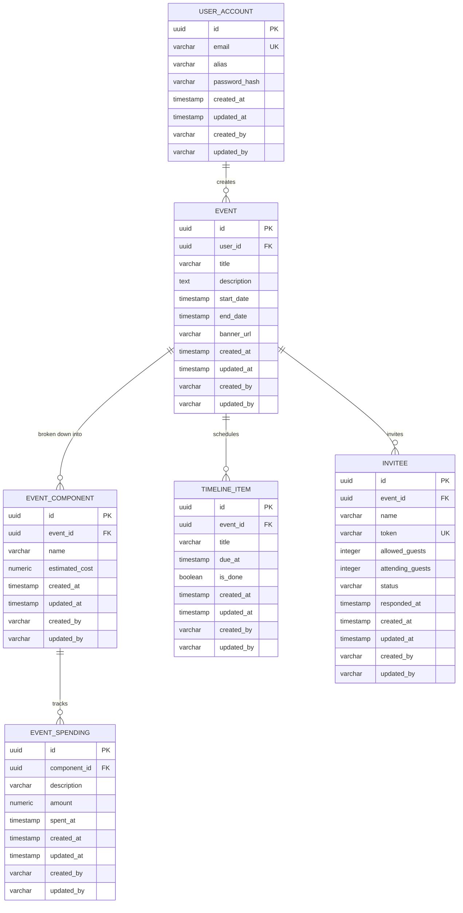

# Planohi Event Planner App Specification

Planohi (Bisaya word for "To Plan") is a comprehensive, self-contained event coordination platform that enables organizers to map out, budget, timeline, and track guest RSVPs.

---

## 1. Core Feature Set

### 🔑 Authentication & Security
* **User Accounts**: Self-registration and login using Email and Password, with a display Alias.
* **JWT Cookie Authentication**: Backend generates a JSON Web Token on successful login and stores it in secure, `HttpOnly`, `SameSite=Strict` cookies. The Next.js frontend routes/proxies request headers automatically.

### 📅 Event Management
* **Event Profiles**: Fields include:
  - Title
  - Description
  - Date Configuration (Single date selector or Date Range Agoda-style picker)
  - Banner image asset url
* **Budget Tracking (EventComponents)**:
  - Events are broken down into components: Venue, Transportation, Organizer, Coordinators, etc.
  - Each component carries an **Estimated Cost**.
  - Total Estimated Cost of the event = Sum of all component estimated costs.
* **Spending Registry**:
  - Individual cash/credit outflows (Spendings) are logged and tagged to specific `EventComponents`.
  - Actual expenditure totals are aggregated and compared against the estimated cost of each component.

### ⏱️ Event Timeline
* **Task Tracker**: Chronological list of event milestones or checklists.
* **Completion State**: Organizers can toggle milestones as "marked as done" to calculate overall completion percentages in real-time.

### ✉️ Personalized RSVP Link
* **Encrypted Invitations**: Each invitee has a secure, unique URL token (UUID v4 or cryptographic hash).
* **Invitee Page**: Public, login-free page showing the invitee's name, event details, and RSVP decision (Accept / Decline).
* **Guest Limit Controls**:
  - Planner configures the `No of allowed guests` per invitee.
  - Upon accepting, the invitee inputs how many additional guests they are bringing (must be <= allowed limit).
  - Real-time guest list count update.

---

## 2. Proposed Database Schema Model (PostgreSQL)

