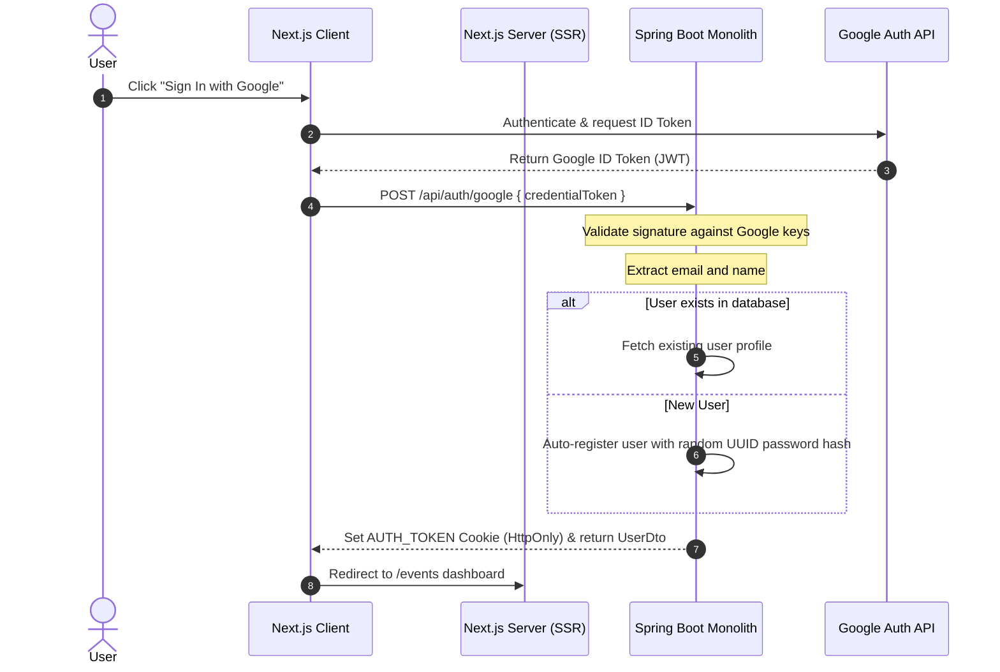

# Sprint 13: Google OAuth2 Login & OTP Resend Cooldown

This sprint introduces Google OAuth2 authentication (sign in and auto-registration) for a frictionless onboarding experience. It also implements a client-side cooldown timer on the OTP Resend button to prevent spamming, and provides instructions for setting up the Google Cloud Console project.

---

## 1. Goals

1. **Google OAuth2 Authentication**: Enable users to log in or register instantly using their Google accounts.
   - **Frontend-Driven Flow**: Next.js uses Google Identity Services (GSI) to render the sign-in button, obtains the secure Google ID Token (JWT), and forwards it to the backend.
   - **Auto-Registration**: If a Google account is not registered, automatically create a new user profile with a default alias (from Google profile name), the `NORMAL` role tier, and a high-entropy dummy password hash.
   - **Session Creation**: Issue our standard HttpOnly `AUTH_TOKEN` session cookie upon successful validation.
2. **OTP Resend Cooldown**: Prevent redundant request spam by adding a client-side visual 60-second cooldown timer on the "Resend OTP" button.
3. **Google Developer Console Integration**: Establish environment variables for Google Client ID across development, staging, and production environments.

---

## 2. User Stories

* **US-13.1 (Google Sign-In / Register)**: As a user, I want to click a "Sign in with Google" button so that I can quickly authenticate without manually entering my password or requesting an OTP.
* **US-13.2 (OTP Cooldown Safeguard)**: As a registering user, once I click "Resend OTP", I want to see a 60-second visual countdown and have the button disabled so that I don't trigger multiple duplicate codes.

---

## 3. Google Developer Console Setup Guide

To enable Google OAuth2, you must create a project and obtain a Client ID from the Google Cloud Console.

### Step 1: Create a Google Cloud Project
1. Navigate to the [Google Cloud Console](https://console.cloud.google.com/).
2. Log in with your Google Workspace or personal Gmail account.
3. Click on the project dropdown in the top navigation bar and select **New Project**.
4. Enter a project name (e.g., `Planohi App`) and click **Create**.

### Step 2: Configure the OAuth Consent Screen
1. In the left-hand menu, navigate to **APIs & Services** > **OAuth consent screen**.
2. Select **External** User Type (unless restricted to a Google Workspace organization) and click **Create**.
3. Fill in the **App Information**:
   - **App name**: `PLANO.HI`
   - **User support email**: *Your support or personal email*
   - **Developer contact information**: *Your email*
4. Click **Save and Continue**.
5. Under **Scopes**, click **Add or Remove Scopes**. Select:
   - `.../auth/userinfo.email` (to retrieve user email)
   - `.../auth/userinfo.profile` (to retrieve name/alias)
6. Under **Test Users**, add the Gmail addresses you will use for testing during local development/staging before the app is verified by Google.
7. Click **Save and Continue** to finish.

### Step 3: Create OAuth 2.0 Credentials (Client ID)
1. Go to the **Credentials** page under APIs & Services.
2. Click **Create Credentials** at the top and select **OAuth client ID**.
3. Select **Web application** as the Application type.
4. Name the client (e.g., `Planohi Local Dev`).
5. **Authorized JavaScript origins**:
   - For Local Dev: `http://localhost:3000`
   - For Staging/Production: `https://staging.planohi.com` (and your ALB domains)
6. **Authorized redirect URIs**:
   - Since we are using the GSI library with a credential callback directly in JavaScript (without server redirects), you can leave this blank or add your login page: `http://localhost:3000/login`.
7. Click **Create**.
8. Copy the **Client ID** (e.g., `xxxxxxxxxxxx-xxxxxxxxxxxxxxxxxxxxxxxx.apps.googleusercontent.com`).

---

## 4. Technical Design



### 1. Database Schema & Migration
Create a new Flyway migration script `V20260628140000__add_auth_provider.sql` under `api/src/main/resources/db/migration`:
```sql
-- Add provider column to user_account
ALTER TABLE user_account ADD COLUMN provider VARCHAR(50) NOT NULL DEFAULT 'SELF_REGISTER';
```

Define the `AuthProvider` enum class under package `com.planohi.api.enums`:
```java
package com.planohi.api.enums;

public enum AuthProvider {
    SELF_REGISTER,
    GOOGLE
}
```

Add the `provider` field to `UserAccount.java` (using `@Enumerated(EnumType.STRING)`):
```java
@Enumerated(EnumType.STRING)
@Column(name = "provider", nullable = false, length = 50)
@Builder.Default
private AuthProvider provider = AuthProvider.SELF_REGISTER;
```

Update `UserDto.java` to expose the login provider:
```java
private com.planohi.api.enums.AuthProvider provider;
```

### 2. Dependency Configurations
Add Google's API Client library to `api/pom.xml` to safely verify and parse ID Tokens:
```xml
<dependency>
    <groupId>com.google.api-client</groupId>
    <artifactId>google-api-client</artifactId>
    <version>2.7.0</version>
</dependency>
```

### 2. Environment Variables
* **Backend (`api`)**:
  - `google.client-id` (environment variable: `GOOGLE_CLIENT_ID`)
* **Frontend (`web`)**:
  - `NEXT_PUBLIC_GOOGLE_CLIENT_ID` (environment variable: `NEXT_PUBLIC_GOOGLE_CLIENT_ID`)

### 3. Backend Implementation (Spring Boot)

#### Endpoint Configuration (`POST /api/auth/google`)
Create `GoogleLoginRequest` and handle it in `AuthController.java`:
```java
@PostMapping("/google")
public ResponseEntity<ApiResponse<UserDto>> googleLogin(
        @Valid @RequestBody GoogleLoginRequest request,
        HttpServletResponse response) {
    
    UserDto user = authService.authenticateGoogleUser(request.getCredentialToken());
    String token = authService.generateToken(user);

    ResponseCookie sessionCookie = ResponseCookie.from("AUTH_TOKEN", token)
            .httpOnly(true)
            .secure(cookieSecure)
            .sameSite("Strict")
            .path("/")
            .maxAge(Duration.ofDays(1))
            .build();
    response.addHeader(HttpHeaders.SET_COOKIE, sessionCookie.toString());

    return ResponseEntity.ok(ApiResponse.success("Logged in with Google successfully", user));
}
```

#### Token Verification and Account Creation (`AuthServiceImpl.java`)
```java
@Override
@Transactional
public UserDto authenticateGoogleUser(String credentialToken) {
    // 1. Initialize Google Token Verifier
    GoogleIdTokenVerifier verifier = new GoogleIdTokenVerifier.Builder(
            new NetHttpTransport(), 
            new GsonFactory())
            .setAudience(Collections.singletonList(googleClientId))
            .build();

    try {
        GoogleIdToken idToken = verifier.verify(credentialToken);
        if (idToken == null) {
            throw new IllegalArgumentException("Invalid Google credential token");
        }

        Payload payload = idToken.getPayload();
        String email = payload.getEmail();
        String name = (String) payload.get("name");

        // 2. Fetch or Auto-Register Account
        UserAccount account = userAccountRepository.findByEmail(email)
                .orElseGet(() -> {
                    log.info("Auto-registering new Google OAuth user: {}", email);
                    // Use a high-entropy random password hash to prevent traditional sign in
                    String randomPassword = UUID.randomUUID().toString() + UUID.randomUUID().toString();
                    
                    UserAccount newAccount = UserAccount.builder()
                            .email(email)
                            .alias(name != null ? name : email.split("@")[0])
                            .passwordHash(passwordEncoder.encode(randomPassword))
                            .role(UserRole.NORMAL)
                            .provider(com.planohi.api.enums.AuthProvider.GOOGLE)
                            .build();
                    return userAccountRepository.save(newAccount);
                });

        return UserDto.builder()
                .id(account.getId())
                .email(account.getEmail())
                .alias(account.getAlias())
                .role(account.getRole())
                .provider(account.getProvider())
                .build();

    } catch (Exception e) {
        log.error("Google token verification failed", e);
        throw new IllegalArgumentException("Failed to verify Google identity: " + e.getMessage());
    }
}
```

---

### 4. Frontend Implementation (Next.js)

#### 1. Load Google Identity Services SDK
Create an injection hook or script loader in `/login` and `/register` components to load `https://accounts.google.com/gsi/client`.

#### 2. Render Google Sign-In Button
Integrate Google's One Tap or button API on the Auth forms:
```typescript
useEffect(() => {
  if (typeof window !== "undefined" && (window as any).google) {
    const google = (window as any).google;
    google.accounts.id.initialize({
      client_id: process.env.NEXT_PUBLIC_GOOGLE_CLIENT_ID,
      callback: handleGoogleCallback,
    });
    google.accounts.id.renderButton(
      document.getElementById("google-signin-btn"),
      { theme: "outline", size: "large", width: "100%" }
    );
  }
}, []);

const handleGoogleCallback = async (response: any) => {
  try {
    const res = await fetchApi<UserDto>("/auth/google", {
      method: "POST",
      body: JSON.stringify({ credentialToken: response.credential }),
    });
    // Redirect to events dashboard
    router.push("/events");
  } catch (err) {
    console.error("Google authentication failed", err);
  }
};
```

#### 3. OTP Resend Cooldown UI Update
In the credential verification screen (Registration OTP entry), add a state timer to manage the resend button cooldown:
```typescript
const [cooldown, setCooldown] = useState(0);

useEffect(() => {
  if (cooldown > 0) {
    const timer = setTimeout(() => setCooldown(cooldown - 1), 1000);
    return () => clearTimeout(timer);
  }
}, [cooldown]);

const handleResend = async () => {
  if (cooldown > 0) return;
  
  await triggerResendOtpApi();
  setCooldown(60); // Initialize 60-second countdown
};

// UI Rendering
<button 
  type="button"
  disabled={cooldown > 0} 
  onClick={handleResend}
  className="disabled:opacity-50 disabled:cursor-not-allowed"
>
  {cooldown > 0 ? `Resend Code (${cooldown}s)` : "Resend OTP Code"}
</button>
```

---

## 5. Verification Plan

### Manual Verification
1. **Google Sign-in**:
   - Access `http://localhost:3000/login`.
   - Click the "Sign in with Google" button.
   - Verify Google authentication popup completes, creates an account in the database (with `NORMAL` role and dummy password), issues the HttpOnly cookie, and redirects cleanly to `/events`.
2. **OTP Resend Cooldown**:
   - Navigate to `/register` and proceed to the OTP screen.
   - Click **"Resend OTP"**.
   - Verify the button displays a countdown (e.g., `Resend Code (60s)`) and is disabled.
   - Verify refreshing/re-clicking during this period is prevented.
